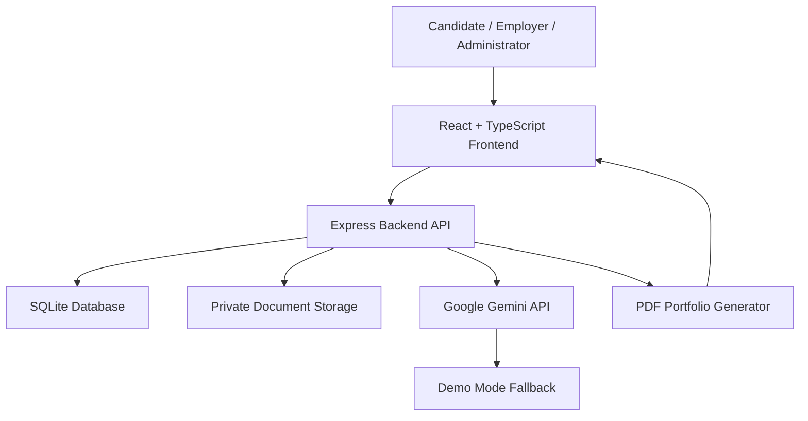

# TalentPath AI

### Your skills crossed borders. Your recognition should too.

**TalentPath AI** is an AI-assisted career and skills recognition platform designed to help skilled refugees and displaced professionals organize their experience, document their competencies, prepare for Recognition of Prior Learning (RPL), and explore professional pathways in Kenya.

Built for the Power Learn Project (PLP) hackathon theme:

**Unlocking Displaced Talent: Pathways for Skilled Refugees**

<p align="center">
  <a href="https://talentpath-ai-322874005096.europe-west2.run.app/">
    <strong>🚀 Launch Live Application</strong>
  </a>
  &nbsp; | &nbsp;
  <a href="https://github.com/thesonofbillionairemom-netizen/TalentPathAI">
    <strong>💻 View Source Code</strong>
  </a>
</p>

---

## Table of Contents

- [The Problem](#the-problem)
- [Our Solution](#our-solution)
- [Core Features](#core-features)
- [How It Works](#how-it-works)
- [Technology Stack](#technology-stack)
- [Application Architecture](#application-architecture)
- [Getting Started](#getting-started)
- [Environment Configuration](#environment-configuration)
- [Demo Experience](#demo-experience)
- [Responsible AI and Data Protection](#responsible-ai-and-data-protection)
- [Project Scope and Limitations](#project-scope-and-limitations)
- [Future Development](#future-development)
- [Hackathon Alignment](#hackathon-alignment)
- [Author](#author)
- [License](#license)

---

## The Problem

Many refugees and displaced professionals have valuable academic qualifications, technical competencies and years of professional experience.

However, crossing borders can make it difficult to:

- Demonstrate qualifications obtained in another country.
- Provide supporting documents when original records are unavailable.
- Understand local qualification recognition procedures.
- Navigate professional licensing and employment requirements.
- Access suitable jobs, mentorship and professional networks.
- Translate previous experience into opportunities in a new labour market.

As a result, skilled individuals may remain underemployed despite possessing valuable capabilities.

## Our Solution

TalentPath AI provides a digital pathway for organizing professional experience, identifying transferable skills, strengthening supporting evidence and navigating relevant recognition and employment preparation processes.

The platform brings together AI-assisted assessment, document management, recognition guidance, career opportunities and professional portfolio preparation in one experience.

**Our goal:** Help displaced professionals make their existing skills more visible, understandable and actionable.

---

## Core Features

### 1. Professional Profile Management

Candidates can organize their professional information, including:

- Personal and professional profile details.
- Academic qualifications.
- Employment history.
- Technical and transferable competencies.
- Career interests and professional goals.

### 2. Document and Evidence Centre

A dedicated space for organizing supporting professional records.

Supported document formats documented by the application include:

- PDF
- PNG
- JPG
- TXT
- DOCX

The application documents a maximum upload size of 10 MB per file.

### 3. AI-Assisted Skills Assessment

Gemini-powered analysis is designed to help:

- Identify technical and transferable skills.
- Analyse professional experience and supporting evidence.
- Highlight potential evidence gaps.
- Suggest career directions.
- Recommend practical next steps.

The assessment distinguishes between user-provided information, evidence-extracted information and AI-generated suggestions.

When live AI analysis is unavailable, the application can fall back to clearly labelled demonstration output.

### 4. Recognition Pathway Navigator

Helps candidates prepare for relevant qualification recognition and Recognition of Prior Learning (RPL) pathways.

The platform references relevant Kenyan institutions and resources, including:

- Kenya National Qualifications Authority (KNQA).
- Technical and Vocational Education and Training Authority (TVETA).
- National Industrial Training Authority (NITA).
- Engineers Board of Kenya (EBK).
- Kenya National Examinations Council (KNEC).
- Department of Refugee Services (DRS).

### 5. Legal and Financial Readiness

Provides a structured place for exploring practical preparation areas related to:

- Work authorisation.
- Employment and regulatory requirements.
- Financial inclusion.
- Banking and payment access.

### 6. Opportunities and Professional Connections

Designed to connect candidate profiles with relevant pathways, including:

- Employment opportunities.
- Mentorship.
- Professional training.
- Skills bridging and apprenticeship opportunities.

Demonstration listings are clearly identified as sample data and should not be interpreted as confirmed vacancies or formal partnerships.

### 7. Professional Portfolio and PDF Export

Candidates can prepare a structured portfolio summarizing their skills, qualifications, evidence and professional experience.

The application uses jsPDF for browser-based PDF generation.

### 8. Privacy and Consent Controls

The platform includes role-based experiences and consent-oriented controls intended to protect candidate information and govern access to shared professional profiles.

---

## How It Works

The intended candidate journey is:

1. **Create a profile** — Enter professional background, qualifications and career interests.
2. **Organize evidence** — Add relevant supporting documents and professional records.
3. **Assess skills** — Run an AI-assisted assessment to identify competencies and potential evidence gaps.
4. **Explore recognition pathways** — Review relevant Kenyan recognition and RPL preparation guidance.
5. **Discover opportunities** — Explore relevant employment, mentorship and training pathways.
6. **Prepare a portfolio** — Generate a structured professional PDF portfolio.

---

## Technology Stack

| Layer | Technologies |
|---|---|
| Frontend | React 19, TypeScript |
| Build tooling | Vite |
| Styling | Tailwind CSS v4 |
| UI and animation | Lucide React, Motion |
| Data visualization | Recharts |
| PDF generation | jsPDF |
| Backend | Node.js, Express |
| Database | SQLite with better-sqlite3 |
| File handling | Multer |
| Password hashing | Node.js crypto / scrypt |
| AI integration | Google Gemini API using @google/genai |
| Deployment | Google Cloud Run |

---

## Application Architecture

The application follows a full-stack architecture.



The frontend communicates with the backend through API routes. Server-side services handle application data, document operations and AI requests.

---

## Getting Started

### Prerequisites

Install the following:

- Node.js (a version compatible with the project dependencies).
- npm.
- Git.
- A Google Gemini API key for live AI functionality.

### 1. Clone the repository

```bash
git clone https://github.com/thesonofbillionairemom-netizen/TalentPathAI.git
```

### 2. Enter the project directory

```bash
cd TalentPathAI
```

### 3. Install dependencies

```bash
npm install
```

### 4. Configure environment variables

Create a local `.env` file using `.env.example` as your reference.

Add your own Gemini API key and other required configuration values.

**Never commit `.env` or expose API keys in frontend code.**

### 5. Start the development server

```bash
npm run dev
```

### 6. Build the application

```bash
npm run build
```

### 7. Run the production server

```bash
npm start
```

---

## Environment Configuration

The project documents the following environment variables:

| Variable | Purpose |
|---|---|
| `GEMINI_API_KEY` | Server-side Google Gemini API authentication |
| `APP_URL` | Application base URL |
| `PORT` | Server listening port; defaults to 3000 |

Use `.env.example` as the configuration reference.

Keep production secrets in the hosting platform's secure environment configuration.

---

## Demo Experience

The application includes a sample demonstration journey.

The repository documents the following demonstration accounts:

| Role | Demo account |
|---|---|
| Candidate | `amina.demo@talentpath.example` |
| Employer / Mentor | `mentor.demo@talentpath.example` |
| Administrator | `admin.demo@talentpath.example` |

These are fictional demonstration identities.

The candidate journey uses sample professional information and demonstration evidence to illustrate how the platform is intended to work.

**Important:** Sample profiles, skills, evidence scores and opportunities are not real refugee records, verified qualifications, confirmed vacancies or actual institutional partnerships.

---

## Responsible AI and Data Protection

TalentPath AI is an AI-assisted career preparation and information platform.

It does not:

- Officially verify academic qualifications.
- Award academic or professional certificates.
- Grant professional licences.
- Grant immigration or employment authorisation.
- Guarantee employment, financial services or institutional approval.
- Replace official assessments by accredited institutions.

AI-generated suggestions must be treated as guidance rather than verified facts.

Candidates should be able to distinguish between:

- Information they personally provided.
- Information extracted from supporting evidence.
- AI-generated suggestions.
- Official recognition or verification issued by authorized institutions.

Personal documents and professional records must be handled with appropriate privacy, security and consent safeguards.

---

## Project Scope and Limitations

TalentPath AI is a hackathon-stage application and demonstration platform.

Some features depend on external services, configuration and availability.

In particular:

- Live Gemini analysis requires a working API key and an available supported model.
- Temporary model-service errors may prevent live assessment and trigger Demo Mode.
- Demonstration opportunities must not be interpreted as verified live listings.
- Official recognition and professional registration remain the responsibility of the relevant Kenyan institutions.

---

## Future Development

Potential improvements include:

- More robust document extraction and evidence analysis.
- Transparent and explainable evidence scoring.
- Improved qualification and occupational-standard mapping.
- Verified opportunity data integrations.
- Expanded refugee work-readiness guidance.
- Stronger employer and mentor collaboration workflows.
- More comprehensive security testing.
- Improved accessibility and multilingual support.
- Automated testing and continuous deployment.

---

## Hackathon Alignment

TalentPath AI addresses the three major focus areas of the PLP hackathon concept.

| Focus Area | Platform Contribution |
|---|---|
| Credential Recognition and Skills Validation | Skills assessment, evidence organization and RPL preparation |
| Legal, Regulatory and Financial Access | Legal and financial readiness guidance |
| Local Experience and Professional Networks | Opportunities, mentorship and professional pathways |

The platform supports the broader goals of:

- **SDG 4:** Quality Education.
- **SDG 8:** Decent Work and Economic Growth.
- **SDG 10:** Reduced Inequalities.
- **SDG 16:** Peace, Justice and Strong Institutions.
- **SDG 17:** Partnerships for the Goals.

---

## Author

**Abdiwali Abdi**  
Designer & Developer — TalentPath AI

GitHub: [@thesonofbillionairemom-netizen](https://github.com/thesonofbillionairemom-netizen)

Project Repository: [TalentPathAI](https://github.com/thesonofbillionairemom-netizen/TalentPathAI)

Live Application: [Launch TalentPath AI](https://talentpath-ai-322874005096.europe-west2.run.app/)

---

## License

No license has currently been specified for this repository.

Unless a license is added, the source code should not be assumed to be open for reuse, modification or redistribution.

---

**TalentPath AI — Skills recognised. Opportunities unlocked.**
