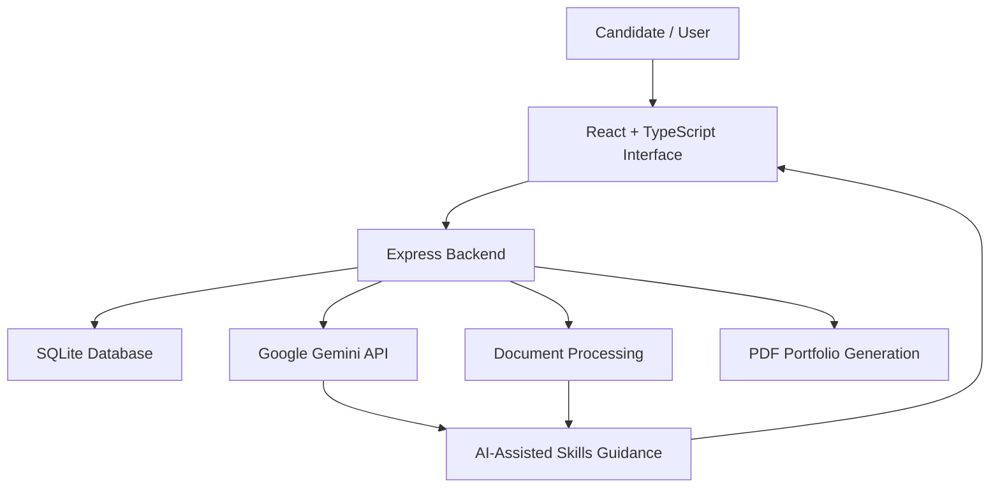

# TalentPath AI

### Your skills crossed borders. Your recognition should too.

**An AI-assisted skills recognition and career pathways platform for skilled refugees and displaced professionals in Kenya.**

<p align="center">
  <a href="https://talentpath-ai-322874005096.europe-west2.run.app/">
    <strong>🚀 VIEW LIVE APPLICATION</strong>
  </a>
  &nbsp; | &nbsp;
  <a href="https://github.com/thesonofbillionairemom-netizen/TalentPathAI">
    <strong>💻 SOURCE CODE</strong>
  </a>
</p>

---

## 🌍 About the Project

TalentPath AI addresses a major challenge facing skilled refugees and displaced professionals: their skills, qualifications, and professional experience may not be easily recognised when they move to a new country.

A professional may have years of engineering, healthcare, construction, ICT, or other experience but struggle to demonstrate their abilities because of missing documents, unfamiliar recognition systems, or limited professional networks.

TalentPath AI provides an AI-assisted platform to help users organise their professional evidence, identify skills, understand potential recognition pathways, and prepare for employment opportunities.

**Our mission:** Help skilled people turn their experience into visible evidence and clearer pathways towards professional inclusion.

## 🎯 The Problem We Address

Skilled displaced professionals can encounter:

- Difficulty proving qualifications obtained in another country.
- Missing or inaccessible academic and employment documents.
- Limited recognition of practical skills and work experience.
- Complex qualification recognition and licensing processes.
- Difficulty understanding local employment readiness requirements.
- Limited access to mentors, employers, and professional networks.

## 💡 Our Solution

TalentPath AI brings several career preparation activities together in one platform.

The platform supports users through a journey:

**PROFILE → EVIDENCE → AI ASSESSMENT → RECOGNITION GUIDANCE → CAREER PATHWAYS**

It is designed to make professional information easier to organise and recognition pathways easier to understand.

## ✨ Key Platform Capabilities

### 1. Professional Profile
Organise professional background, experience, qualifications, and career interests in one place.

### 2. Evidence Organisation
Upload and organise supporting documents and professional evidence.

### 3. AI-Assisted Skills Assessment
Use AI-assisted analysis to identify potential competencies, organise evidence, and highlight missing information.

### 4. Recognition Pathway Guidance
Explore potential qualification recognition and Recognition of Prior Learning (RPL) preparation pathways.

### 5. Career Readiness
Identify documentation gaps and prepare for relevant employment and professional requirements.

### 6. Professional Portfolio
Prepare a structured professional portfolio that can support career and recognition discussions.

> Feature availability and AI service performance may vary. Demonstration data is illustrative and must not be treated as verified personal information or live employment opportunities.

## 🧭 Three Innovation Pillars

| Pillar | Focus |
|---|---|
| Credential Recognition & Skills Validation | Organising qualifications, practical skills, and supporting evidence |
| Legal, Regulatory & Financial Readiness | Understanding relevant documentation and official readiness requirements |
| Local Experience & Professional Networks | Exploring mentorship, career development, and professional connections |

## 🛠️ Technology Stack

The project uses the following technologies as documented in its source repository:

| Technology | Purpose |
|---|---|
| React 19 | User interface |
| TypeScript | Application development |
| Vite | Development and build tooling |
| Tailwind CSS | Interface styling |
| Node.js | Server-side runtime |
| Express | Backend application framework |
| SQLite | Database |
| Google Gemini API | AI-assisted analysis |
| Multer | File upload handling |
| jsPDF | PDF generation |

## 🏗️ High-Level Architecture



## 🇰🇪 Kenyan Recognition Context

TalentPath AI is designed with the Kenyan professional and qualifications landscape in mind.

Relevant institutions and pathways to explore include:

- **KNQA** — Kenya National Qualifications Authority.
- **TVETA** — Technical and Vocational Education and Training Authority.
- **NITA** — National Industrial Training Authority.
- **EBK** — Engineers Board of Kenya.
- **Recognition of Prior Learning (RPL)** — A pathway for assessing competencies gained through work and other experience.

TalentPath AI does not issue official qualifications, approve licensing, or replace these institutions.

## 🔐 Responsible AI, Privacy & Trust

Trust is essential when working with personal qualifications and professional documents.

The project follows these important principles:

- AI-generated recommendations are guidance, not official certification.
- Skills extracted from documents must be distinguished from user-provided claims and AI-generated suggestions.
- Qualification recognition and professional licensing remain the responsibility of authorised institutions.
- Legal and financial information should be treated as guidance, not a guarantee of approval.
- Sample accounts and demonstration opportunities are not verified real-world opportunities.
- Personal documents should only be shared with appropriate consent and safeguards.

Security and privacy controls should be independently tested before making claims of complete protection.

## 🚀 Getting Started

### Prerequisites

- Node.js compatible with the project's dependencies.
- npm or the package manager supported by the repository lockfile.
- A Google Gemini API key for live AI functionality.

### Installation

Clone the repository:

```bash
git clone https://github.com/thesonofbillionairemom-netizen/TalentPathAI.git
cd TalentPathAI
```

Install dependencies using the package manager configured for the project.

For npm:

```bash
npm install
```

Configure the environment variables using the provided `.env.example` file. For example:

```env
GEMINI_API_KEY=your_gemini_api_key
PORT=3000
APP_URL=http://localhost:3000
```

Never commit real API keys or secrets to GitHub.

### Run the application

Use the development command defined in `package.json`.

```bash
npm run dev
```

Build the application:

```bash
npm run build
```

For production startup, use the start script defined in the project configuration.

> Check the actual scripts and package-manager lockfile in the repository before running these commands. Exact setup requirements may differ by project version.

## 📸 Application Preview

Actual screenshots of the deployed application will be added here.

Recommended screenshots:

- Candidate dashboard.
- AI skills assessment.
- Document and evidence centre.
- Recognition pathway guidance.
- Professional portfolio.

Screenshots should represent the real application, not generated mock interfaces.

## 📈 Social Impact

TalentPath AI aims to contribute to:

- **SDG 4 — Quality Education:** Supporting skills development and recognition of prior learning.
- **SDG 8 — Decent Work and Economic Growth:** Helping skilled professionals prepare for employment pathways.
- **SDG 10 — Reduced Inequalities:** Supporting professional inclusion.
- **SDG 17 — Partnerships for the Goals:** Encouraging collaboration between employers, institutions, mentors, and support organisations.

These are intended contributions, not measured impact claims.

## 🔭 Future Development Roadmap

- Improve AI availability and reliability.
- Strengthen document extraction and evidence quality.
- Improve accessibility and user experience.
- Validate recognition guidance with relevant institutions.
- Expand skills and career pathway coverage.
- Develop meaningful employer and mentorship connections.
- Strengthen privacy, security, and testing.

## ⚠️ Project Status & Limitations

TalentPath AI is a developing project and should be treated as a prototype.

- AI analysis depends on external service availability and configuration.
- Demo Mode may be used when live AI services are unavailable.
- Suggested skills and career pathways require human review.
- Demonstration opportunities are not necessarily live vacancies.
- Official qualification recognition, licensing, work authorisation, and financial approval cannot be guaranteed by the platform.

## 👨‍💻 Developer

**Designed and Developed by Abdiwali Abdi**

GitHub: [@thesonofbillionairemom-netizen](https://github.com/thesonofbillionairemom-netizen)

Project: [TalentPath AI](https://github.com/thesonofbillionairemom-netizen/TalentPathAI)

Live application: [Open TalentPath AI](https://talentpath-ai-322874005096.europe-west2.run.app/)

---

<p align="center">
  <strong>Recognise the skills. Unlock the potential. Build the future.</strong>
  <br/>
  TalentPath AI
</p>
